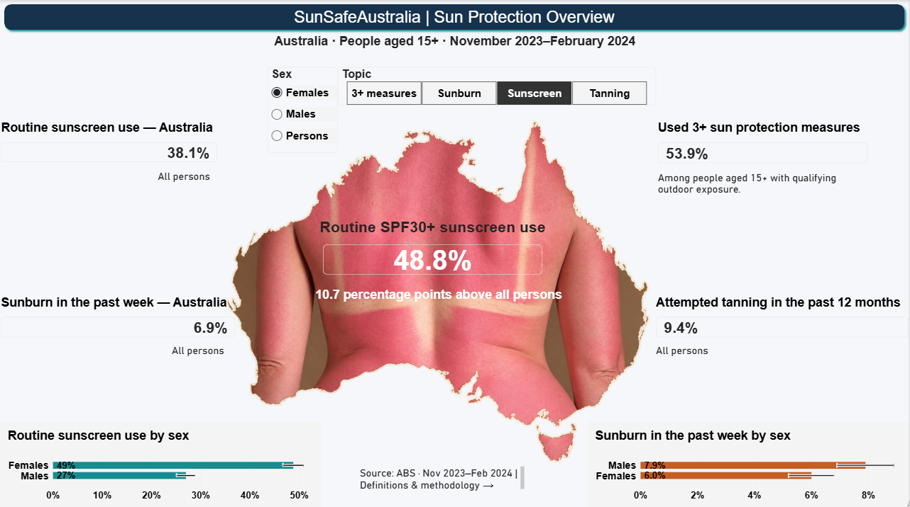
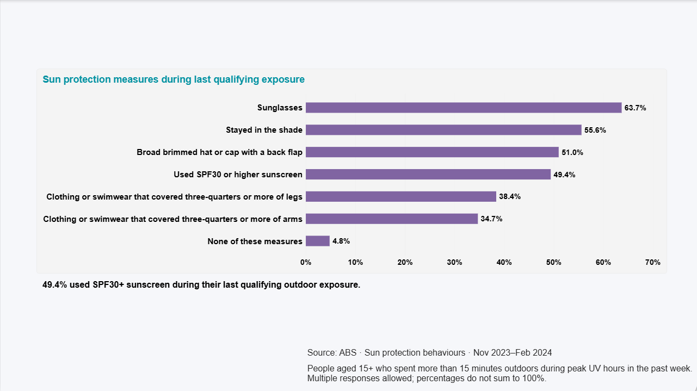
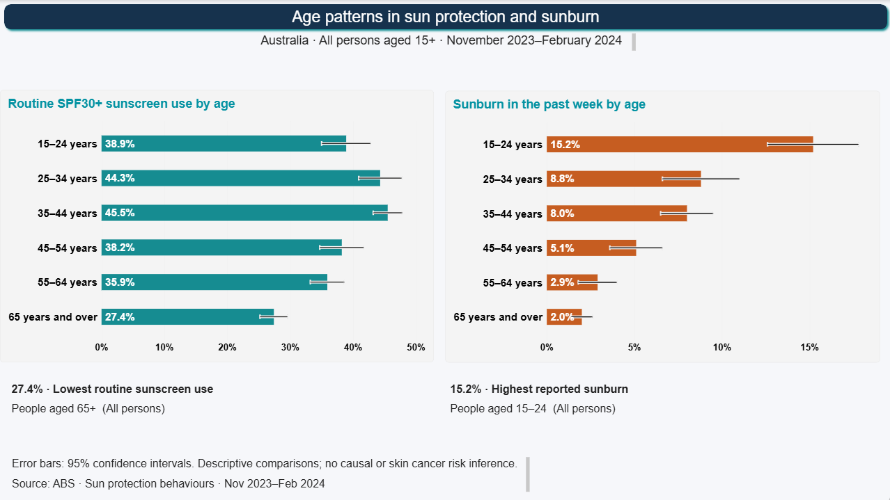
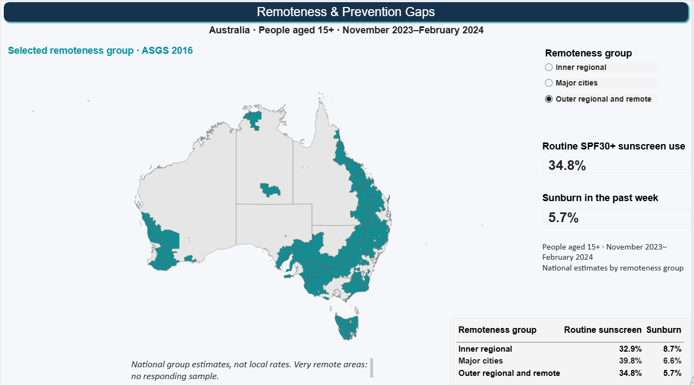

# SunSafeAustralia

**Australian sun protection behaviours, explored with SQL Server and Power BI.**

This portfolio project turns ABS published survey tables into an interactive report about routine sunscreen use, recent sunburn, tanning and protective behaviours. It helps analysts and prevention teams explore demographic differences while preserving survey denominators and uncertainty.

**Author:** S. Hossein Alaeinejad

## Selected findings

- 38.1% of people aged 15+ reported routine SPF30+ sunscreen use: 48.8% of females and 27.0% of males.
- 6.9% reported sunburn in the past week.
- The highest published age-group sunburn estimate was 15.2% for people aged 15–24.
- The lowest routine sunscreen estimate by age was 27.4% for people aged 65+.
- During the last qualifying outdoor exposure, 49.4% used SPF30+ sunscreen and 53.9% used three or more protection measures. These estimates have a different denominator from routine use.

These are descriptive survey estimates, not causal findings or skin cancer risk predictions.

## Report pages

1. **Visual Overview** — topic and sex selectors, national references and subgroup comparisons.
2. **Protection Behaviours** — use of seven protection measures during the last qualifying exposure.
3. **Audience & Prevention Gaps** — age patterns with 95% confidence intervals.
4. **Remoteness & Prevention Gaps** — national remoteness-group estimates on ASGS 2016 boundaries.
5. **Methodology & Sources** — definitions and interpretation.

A hidden **Topic Tooltip** page provides supporting context.

## Screenshots

### Visual Overview

### Protection Behaviours

### Audience & Prevention Gaps

### Remoteness & Prevention Gaps

Screenshots supplied by the author. The PBIX is unchanged from the supplied report; subsequent formatting changes require a refreshed PBIX.

## Architecture

ABS published aggregate tables → SQL staging tables → `rpt.vwSunProtection` → Power BI import model and DAX → interactive report.

The reporting layer is a unified aggregate view; it is not an individual-level clinical dataset or a dimensional star schema.

## Run locally

Prerequisites: SQL Server 2022 (the author's environment), SSMS and a recent Power BI Desktop version compatible with the supplied PBIX.

1. Run `sql/01_ABS_InitialLoad.sql` in SSMS. It creates `SunSafeAustraliaDW` if needed and loads Tables 1–2.
2. Run `sql/02_ABS_ExtendedLoad.sql` to load Tables 3–5.
3. Run `sql/03_CreateReportingView.sql` to create the `rpt` schema and unified view.
4. Run `sql/04_Validation.sql`; expected total: **1,605 rows**.
5. Open `powerbi/SunSafeAustralia.pbix`. For refresh, change its SQL Server data source to your own instance and authenticate locally. Import `rpt.vwSunProtection` as `SunProtection` if rebuilding.

The two load scripts contain embedded published values and do not require an Excel path. Re-running them skips existing keys; it does not update revised source values. The view script is rerunnable.

## Interpretation

- Published marginal breakdowns cannot be freely crossed (for example, age × occupation × remoteness).
- Do not add subgroup percentages or sum overlapping categories.
- Counts are population estimates in thousands, not survey sample counts. Some Table 4 measures use days instead.
- `MarginOfError95PP` is a 95% margin of error in percentage points, not a standard error. Missing uncertainty is not zero.
- Map colours represent national group estimates or selection, not local rates, UV intensity or cancer risk.
- The central Australia-shaped photograph is illustrative, not a geographic data layer.
- No brand sales, product effectiveness or market-demand estimates are included.

See [methodology](docs/METHODOLOGY.md), [sources and attribution](docs/SOURCES.md) and [review notes](docs/REVIEW.md).

## Sources

[ABS Sun protection behaviours methodology, Nov 2023–Feb 2024](https://www.abs.gov.au/methodologies/sun-protection-behaviours-methodology/nov-2023-feb-2024), published workbook `SPBDC01.xlsx`, Tables 1–5, and ABS ASGS 2016 remoteness boundaries.

## Reuse

ABS data, boundary data and embedded imagery have their own attribution and reuse requirements. No blanket licence is asserted over third-party assets; see `docs/SOURCES.md`.
